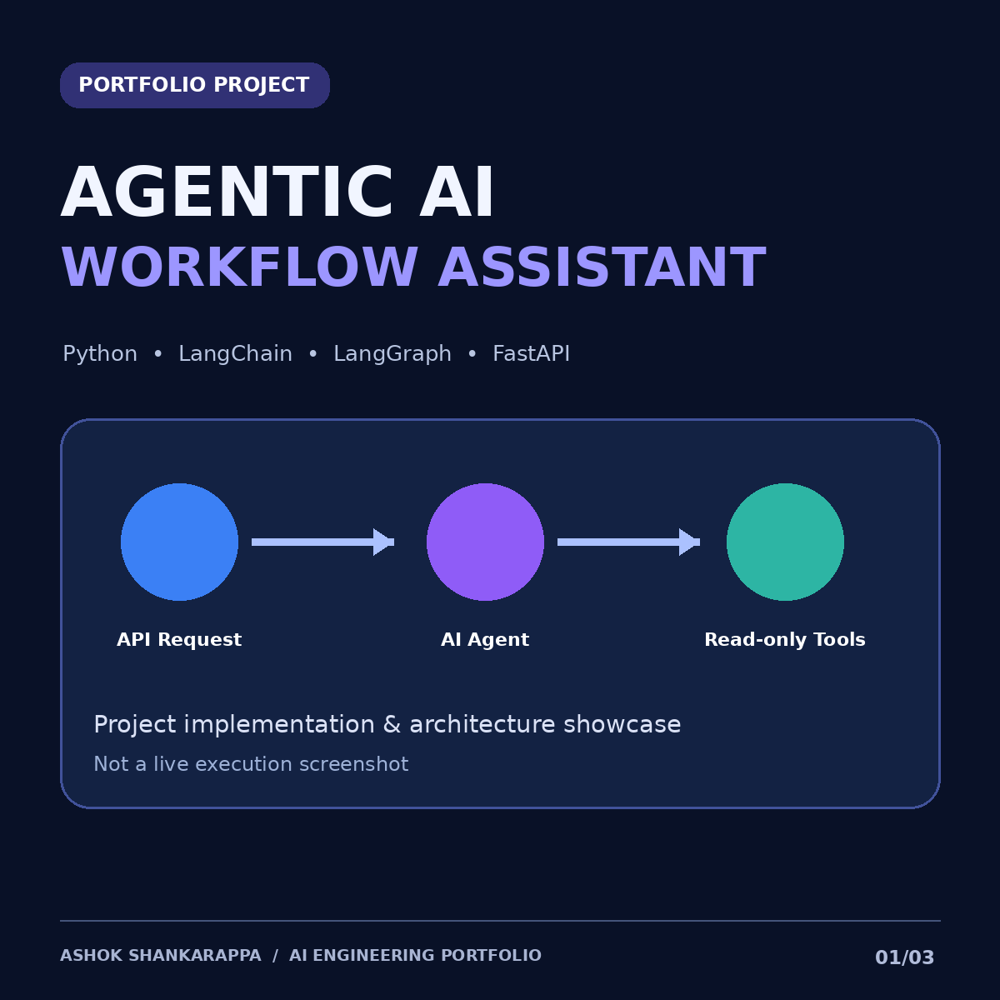
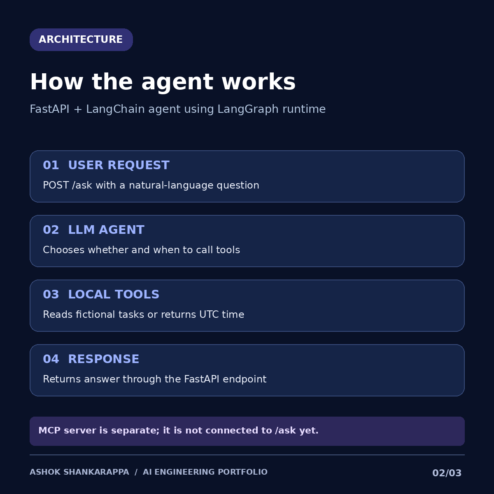

<div align="center">



# Agentic AI Workflow Assistant

**A Python/FastAPI demonstration of a tool-using LLM agent, with a separate MCP tool server.**

    

[Architecture](#architecture) · [Features](#features) · [Run locally](#run-locally) · [API](#api-usage) · [MCP](#mcp-tool-server) · [Roadmap](#roadmap)

</div>

> **Project status:** source-code portfolio demo. The FastAPI agent uses **local read-only Python tools**. The MCP server is a **separate stdio process** and is **not connected** to the HTTP agent. Deployment, end-to-end cloud operation, and real-client integrations are not claimed. The task data is fictional.

## Overview

This project illustrates how an LLM-powered assistant can answer natural-language questions about a small set of demo tasks by choosing available tools. The API is implemented with FastAPI, while the agent uses LangChain `create_agent` with a LangGraph-based runtime. A separate MCP server exposes similar read-only tools to MCP-capable clients.

## Architecture



```text
HTTP path:
User -> POST /ask -> FastAPI -> LangChain create_agent -> OpenAI model
                                              |
                                              +-> local list_tasks()
                                              +-> local current_utc_time()
                                              |
                                         JSON answer

Independent MCP path:
MCP-capable client -> stdio -> mcp_server.py -> list_project_tasks() / utc_time()
```

**Boundary:** `app.py` does *not* use MCP to invoke `mcp_server.py`. MCP client integration is planned future work.

## Features

- Natural-language question answering using an OpenAI-backed agent.
- Agent-selectable **read-only** tools for fictional tasks and UTC time.
- REST endpoints (`GET /health`, `POST /ask`) with automatic OpenAPI docs.
- Independent MCP tool server that can be connected to a compatible client.
- Container packaging with Docker and environment-based configuration.
- Explicit limits and security guidance for further development.

## Tech stack

| Layer | Implementation |
| --- | --- |
| Language | Python 3.11+ |
| API | FastAPI + Uvicorn |
| Agent | LangChain `create_agent` (LangGraph-based execution) |
| Model | OpenAI model configured by `OPENAI_MODEL` (default: `gpt-4.1-mini`) |
| Tools | Read-only Python functions |
| MCP | Python MCP `FastMCP`, stdio server (separate process) |
| Packaging | Docker |

## Run locally

**Requirements:** Python 3.11+, an OpenAI API key, and internet access for model calls. API usage may incur charges.

```bash
# From this repository's root directory
python -m venv .venv
source .venv/bin/activate       # Windows PowerShell: .venv\Scripts\Activate.ps1
pip install -r requirements.txt

# macOS/Linux: set the key in the current shell; don't add it to Git
export OPENAI_API_KEY="your-api-key"
uvicorn app:api --reload --port 8000
```

For Windows PowerShell, set the key with `$env:OPENAI_API_KEY="your-api-key"`. An optional `.env.example` describes expected variables; do not commit a real `.env`. Note: this app reads environment variables from the process, **not automatically from `.env`**.

Open **http://127.0.0.1:8000/docs** to explore the API.

## API usage

**Health check** (does not require the OpenAI key):

```bash
curl http://127.0.0.1:8000/health
```

Expected shape: `{"status":"ok","mode":"demo"}`.

**Ask the agent** (requires a valid API key and working model access):

```bash
curl -X POST http://127.0.0.1:8000/ask \
  -H "Content-Type: application/json" \
  -d '{"question":"Which demo tasks are still open?"}'
```

The response is JSON with an `answer` field. The precise wording is generated by the model and may vary. Demo tasks are defined in `app.py` and are **not persisted**.

## MCP tool server

Start a separate stdio MCP server:

```bash
python mcp_server.py
```

To test it, configure an MCP-capable client to launch your Python interpreter with the **absolute path** to `mcp_server.py`. The MCP server exposes `list_project_tasks(status)` and `utc_time()` as independent read-only tools. Its process is **not accessed by `POST /ask`** in the current version.

## Docker

```bash
docker build -t agentic-ai-demo .
docker run --rm -p 8000:8000 \
  -e OPENAI_API_KEY="$OPENAI_API_KEY" agentic-ai-demo
```

On Windows, adapt variable expansion to your shell. Docker hosts the API only; the MCP server is not started automatically by the Dockerfile.

## Evidence gallery

The diagrams above are **designed illustrations**, not terminal/browser screenshots. Add images captured from your own computer after testing the app:

| Real screenshot | How to capture |
| --- | --- |
| `screenshots/01-local-server.png` | Terminal after successful `uvicorn` startup |
| `screenshots/02-fastapi-docs.png` | Open `/docs` in your browser |
| `screenshots/03-api-response.png` | Execute `POST /ask` and capture successful output |
| `screenshots/04-mcp-client.png` | Only after testing the server with a real MCP client |

Once files are added, replace this gallery table with Markdown images, for example:

```md

```

## Repository structure

```text
.
├── app.py                 # FastAPI and local-tool agent
├── mcp_server.py          # Independent stdio MCP server
├── requirements.txt
├── Dockerfile
├── .env.example
├── .gitignore
├── README.md
├── assets/
│   ├── project-cover.png
│   └── architecture.png
└── screenshots/
    └── README.md          # Instructions for real screenshots
```

## Security and limitations

- No authentication, rate limits, quotas, or per-user isolation in this starter API. **Do not expose `/ask` publicly** without adding these protections and monitoring costs.
- The demo tools are read-only, operate on hardcoded fictional tasks, and do not access client systems.
- Model calls require a valid OpenAI API key; never commit secrets or screenshots showing them.
- No production deployment, persistence, automated evaluation, or MCP-to-agent connection has been verified.

## Roadmap

- [ ] Add automated unit and API integration tests.
- [ ] Connect the LangChain agent to the MCP server through an MCP client.
- [ ] Add persistent tasks with a database and user authentication.
- [ ] Add tracing, evaluations, and safe error handling.
- [ ] Add rate limits, token budgets, and deployment observability.
- [ ] Publish a verified local demo video and genuine screenshots.

## Author

**Ashok Shankarappa** · [GitHub](https://github.com/Ashok98765vvs) · [LinkedIn](https://www.linkedin.com/in/ashok-s1/)

---

*Portfolio prototype. All task records are synthetic; any screenshots should document an actual run rather than a simulated one.*
